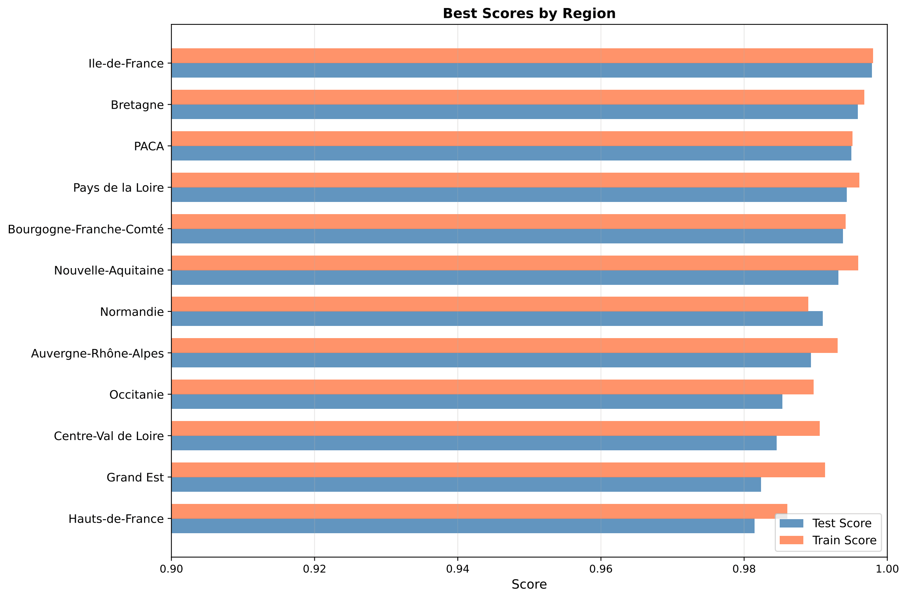

# Forecasting French Regional Electricity Consumption from Weather Data

Predicting hourly and daily electricity consumption for the 12 regions of mainland France from Météo-France weather observations, calendar effects and recent consumption, comparing four regression models under a strict time-series evaluation.

> Solo project · M1 Computer Science, Decision, Data (Université Paris Dauphine – PSL) · March – April 2026
> 📄 [Full report (55 pages)](report/report.pdf) · 🎤 [Slides](report/slides.pdf)




## Key results

Models were tuned with time-series cross-validation, retrained on all data before 2024, then evaluated **once on the full year 2024, never seen during training or tuning**. Scores are R² on the hourly datasets at region scale.

| Model | Mean R² (12 regions) | Hardest region | Fit time* |
|---|---|---|---|
| **Ridge regression** (polynomial features) | **0.990** | 0.981 (Hauts-de-France) | 1.7 s |
| AdaBoost on regression trees | 0.991 | 0.982 (Grand Est) | 199 s |
| Regression tree | 0.984 | 0.974 (Occitanie) | 0.4 s |
| Polynomial regression | 0.983 | 0.969 (Centre-Val de Loire) | 1.2 s |

<sub>*Mean fit time of the best configuration during cross-validation, per region.</sub>

**Takeaways**

- **Ridge is the best trade-off:** same accuracy as AdaBoost, about 100× faster to train. On the daily datasets it is also the winner (cross-validation R² 0.976).
- **Recent consumption dominates:** feature importances show Ridge relies mostly on the last observed consumptions and calendar features; temperature matters more at daily scale.
- **More features ≠ better:** department-level weather (up to 167 features) and PCA reduced accuracy. With PCA (0.5% information loss), Ridge dropped from 0.987 to 0.827 in cross-validation.
- **Gap-filling did not help:** imputing missing weather values from neighbouring stations (~30 h of compute) left scores unchanged (0.976 → 0.976).
- **Some regions are harder:** Île-de-France is consistently the easiest, Hauts-de-France and Centre-Val de Loire the hardest.

## Data

| Source | Content | Volume |
|---|---|---|
| [Météo-France on data.gouv.fr](https://www.data.gouv.fr/datasets/donnees-climatologiques-de-base-quotidiennes) | Daily (2013–2024) and hourly (2020–2024) observations from 4,006 stations in 94 departments | ~24 GB raw |
| [RTE éCO2mix](https://www.rte-france.com/donnees-publications/) | Regional consumption every 30 min, 2013–2024 (Corsica not covered) | 12 files, ~2 MB each |

Resulting datasets per region: **4,383 daily rows** and **43,848 hourly rows**.

## Method

**1. Building the datasets**
- Selected weather variables by relevance and filling rate across stations (daily: precipitation, min/max/mean temperature, frost duration, wind; hourly: same plus dew point and humidity).
- Aggregated stations to region scale (one feature set per region) or department scale (one feature set per department, 26 to 167 columns).
- Merged with RTE consumption, aggregated to hourly or daily totals.

**2. Feature engineering**
- Sine/cosine encoding of day of year, day of week and hour, to capture seasonal, weekly and daily cycles (weekends and nights are clearly visible in the data).
- Lag features: the last *c* observed consumptions (*c* tuned as a hyperparameter, up to 24 for hourly data).
- Optional PCA with a tunable information-loss threshold.

**3. Missing values**
- Missing values come in long gaps (weeks or months), so simple interpolation was not enough.
- Filled each gap with the mean of the 5 nearest stations, using a `BallTree` with haversine distance and extending the search when neighbours were also missing.

**4. Training and evaluation**
- Four scikit-learn pipelines: polynomial regression, Ridge, regression trees, AdaBoost on regression trees. One model per region.
- Hyperparameter search with `GridSearchCV` and `TimeSeriesSplit`, with a gap between training and validation folds (11 days / 50 hours) so that lag features cannot leak future information.
- Final evaluation on 2024 only, after retraining on all previous data.

## Limitations and next steps

- **Baseline.** The models lean heavily on the previous consumption. A persistence baseline (predicting the last observed value) is needed to quantify how much the weather and calendar features really add.
- **Comparison with RTE.** RTE's official day-ahead forecasts reach a similar R² in recent years, but they are national, so the comparison is only indicative.
- **Station weighting.** Stations are unevenly distributed, so a simple mean over-represents dense areas. Weighting stations by covered area or population could give better regional features.
- **Richer data.** Using station-level features directly, or hourly data back to 2013, would require more compute and stronger regularisation.

## Repository structure

```
├── README.md
├── requirements.txt
├── report/          # Full report (PDF) and presentation slides
├── src/
│   ├── MLfunctions.py      # CLI: grid search and scoring
│   └── createDataSet.py    # CLI: download and build the datasets
├── configs/         # Default hyperparameter grids per model (JSON)
├── data/            # Links to raw data, preprocessed RTE files (datasets are generated here)
├── notebooks/       # Exploration: missing data, exploratory analysis, error analysis
├── results/         # Figures and grid search / scoring results (JSON)
└── docs/USAGE.md    # Detailed CLI reference
```

## Quick start

```bash
pip install -r requirements.txt

# 1. Download the Météo-France files and build the datasets (long: ~24 GB to download)
python src/createDataSet.py
#    or only what you need, e.g. daily data for one region
python src/createDataSet.py --delta ByDay --scale Region --regions Bretagne

# 2. Tune a model with time-series cross-validation
python src/MLfunctions.py gridsearch --delta ByHour --scale Region --model ridgeReg --saveN 1

# 3. Score the tuned model on the test period
python src/MLfunctions.py scoring --delta ByHour --scale Region --model ridgeReg --save true
```

All options (model parameters, filled datasets, train/test split date…) are documented in [docs/USAGE.md](docs/USAGE.md).

## Tech stack

Python · scikit-learn · pandas · NumPy · Matplotlib

## Author

**Félix de Batz** – M2 IASD student (PSL: ENS, Mines Paris, Dauphine) · [LinkedIn](https://www.linkedin.com/in/felix-de-batz) · felibatz@gmail.com